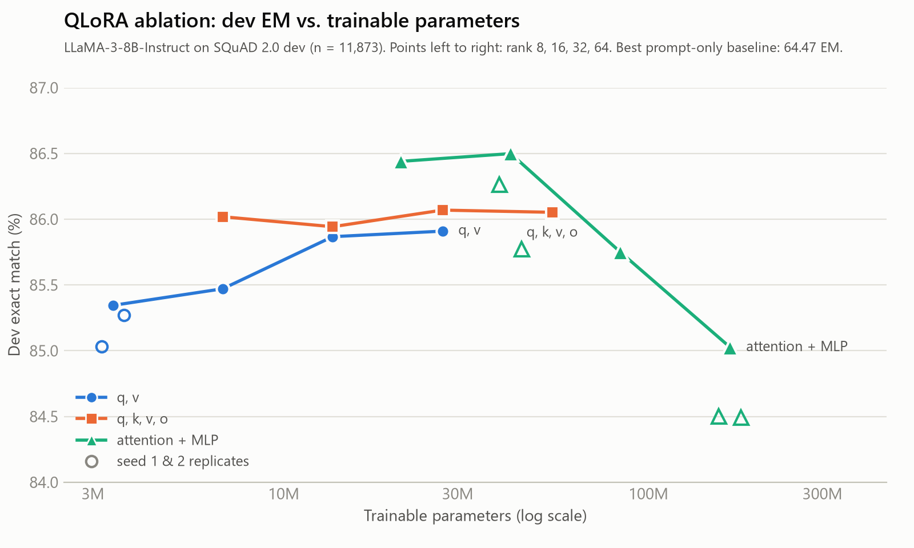

# LLaMA-3-8B on SQuAD 2.0: Hallucination vs. Abstention

Does LLaMA-3-8B-Instruct make up an answer when a question can't be answered from the passage,
or does it correctly say "no answer"? This project measures that on
[SQuAD 2.0](https://rajpurkar.github.io/SQuAD-explorer/), where half of the dev-set questions are
deliberately unanswerable, and then tries to fix it with prompting and QLoRA fine-tuning.

All numbers below come from real runs on the full dev set (11,873 questions) on a single RTX 4090.
Raw model outputs for every run are in [`outputs/`](outputs/) and metrics in [`results/`](results/).

## Key findings

1. **Out of the box, LLaMA-3-8B-Instruct hallucinates on 82% of unanswerable questions** when the
   prompt doesn't mention that abstaining is allowed.
2. **Prompting helps, but only partway.** Allowing abstention halves hallucination (44.6%);
   few-shot examples give the best prompt-only EM (64.47); a self-check verifier gives the lowest
   prompt-only hallucination (35.9%).
3. **QLoRA fine-tuning is the big win: +31 EM points** over the same prompt (54.1 → 85.0–86.5) and
   hallucination down to ~10–12%, at the cost of over-abstention rising from ~2% to ~6%. Even the
   smallest adapter (3.4M trainable params, 0.04% of the model) beats every prompt.
4. **More trainable parameters don't help.** Across a 49× range of adapter sizes, EM moves by only
   1.5 points, and the largest adapter (attention + MLP, rank 64) is the *worst*, consistently across
   3 seeds.
5. **Seed noise matters for hallucination.** EM is stable across seeds (std 0.16–0.37), but
   hallucination rate swings by up to 2.9 points between seeds of the same config, so small
   hallucination differences between single runs shouldn't be trusted.

<picture>
  <source media="(prefers-color-scheme: dark)" srcset="figures/params_vs_em_dark.png">
  
</picture>

## Results

### Metrics

| Metric | Computed over | Meaning |
|---|---|---|
| EM / F1 | all questions | Exact match / token-overlap F1 after SQuAD normalization, max over reference answers |
| HasAns EM | answerable questions | How well it answers when there *is* an answer |
| NoAns accuracy | unanswerable questions | How often it correctly abstains |
| Hallucination rate | unanswerable questions | % where it answered anyway (= 100 − NoAns accuracy) |
| Over-abstention rate | answerable questions | % where it said "no answer" although one exists |

Hallucination and over-abstention are always reported together: either one alone can be gamed
(never answer → 0% hallucination; always answer → 0% over-abstention). Scoring is implemented in
[`metrics.py`](metrics.py) and matches Hugging Face's official `squad_v2` scorer exactly
([`check_metrics.py`](check_metrics.py)).

### Prompt variants (base model, no fine-tuning)

| Prompt | EM | F1 | HasAns EM | NoAns acc | Hallucination | Over-abstention |
|---|---|---|---|---|---|---|
| zero-shot | 36.71 | 47.31 | 55.35 | 18.12 | **81.88** | 0.12 |
| explicit abstention instruction | 54.12 | 64.67 | 52.88 | 55.36 | 44.64 | 1.80 |
| few-shot (2 answerable + 2 unanswerable demos) | **64.47** | **70.01** | **77.90** | 51.08 | 48.92 | 1.84 |
| self-check (separate verifier call) | 58.58 | 68.84 | 53.02 | **64.12** | **35.88** | 3.88 |

### QLoRA ablation (abstention prompt, seed 0)

| Target modules | Rank | Trainable params | % of model | EM | F1 | Hallucination | Over-abstention |
|---|---|---|---|---|---|---|---|
| — (base model) | — | 0 | 0 | 54.12 | 64.67 | 44.64 | 1.80 |
| q, v | 8 | 3,407,872 | 0.042 | 85.34 | 88.38 | 12.21 | 6.16 |
| q, v | 16 | 6,815,744 | 0.085 | 85.47 | 88.51 | 12.28 | 5.85 |
| q, v | 32 | 13,631,488 | 0.169 | 85.87 | 88.76 | 11.83 | 5.97 |
| q, v | 64 | 27,262,976 | 0.338 | 85.91 | 88.85 | 11.27 | 6.33 |
| q, k, v, o | 8 | 6,815,744 | 0.085 | 86.02 | 88.97 | 11.64 | 5.74 |
| q, k, v, o | 16 | 13,631,488 | 0.169 | 85.94 | 88.91 | 12.03 | 5.52 |
| q, k, v, o | 32 | 27,262,976 | 0.338 | 86.07 | 88.96 | 11.35 | 5.97 |
| q, k, v, o | 64 | 54,525,952 | 0.674 | 86.05 | 89.05 | **10.21** | 6.95 |
| attention + MLP | 8 | 20,971,520 | 0.260 | 86.44 | 89.32 | 10.83 | 6.22 |
| attention + MLP | 16 | 41,943,040 | 0.520 | **86.50** | **89.43** | 10.46 | 6.34 |
| attention + MLP | 32 | 83,886,080 | 1.034 | 85.75 | 88.84 | 11.07 | 6.41 |
| attention + MLP | 64 | 167,772,160 | 2.046 | 85.02 | 88.24 | 10.66 | 7.74 |

Trainable-parameter counts are from peft's `print_trainable_parameters()` and stored per run in
`adapters/<config>/train_info.json`.

### Seed replicates

Three configs were retrained with seeds 1 and 2 (same data and settings).

| Config | EM (seed 0 / 1 / 2) | EM mean ± std | Hallucination mean (range) |
|---|---|---|---|
| q, v · r8 | 85.34 / 85.03 / 85.27 | 85.22 ± 0.16 | 12.70 (0.76) |
| attention + MLP · r16 | 86.50 / 86.26 / 85.77 | 86.18 ± 0.37 | 11.11 (1.67) |
| attention + MLP · r64 | 85.02 / 84.50 / 84.49 | 84.67 ± 0.30 | 12.22 (2.89) |

Every attention+MLP r16 seed beats every q,v r8 seed, and all three r64 seeds score lowest. With
3 seeds this is consistent evidence, not a formal significance test. EM differences under about
0.5–1 point elsewhere in the grid are within run-to-run noise.

## How it works

**Evaluation pipeline** ([`pipeline.py`](pipeline.py)): a LangGraph graph
`load → prompt → generate → parse → [judge] → score`. Generation goes to a vLLM server
(OpenAI-compatible API, `vllm/vllm-openai:v0.31.0` in Docker) with up to 256 concurrent requests
and greedy decoding; a full-dev run takes about 2 minutes. LoRA adapters are served by the same
vLLM server and selected by model name.

**Parsing and the LLM judge** ([`prompts.py`](prompts.py)): the model's free text is turned into
either an answer string or an abstention two ways: a regex parser, and an LLM-as-a-judge
(LLaMA-3-8B-Instruct) that classifies each response as ABSTAIN or ANSWER. The judge sees only the
response, not the question: with the question it tended to judge *correctness* instead.
Both scorings are saved; tables above use the parser (judge-scored numbers are in `results/`).

**Self-check**: a second, separate call asks the model whether the passage supports its proposed
answer (SUPPORTED / UNSUPPORTED). An earlier version that asked the model to "check your answer"
in the same conversation made it apologize and retract correct answers (sycophancy).

**QLoRA** ([`train.py`](train.py)): LLaMA-3-8B-Instruct loaded in 4-bit NF4 with double
quantization and bf16 compute; LoRA with α = 2r and dropout 0.05; loss on the answer tokens only;
1 epoch over 10,000 SQuAD 2.0 train examples (natural 33% unanswerable), effective batch 16,
lr 2e-4 with cosine schedule; ~27–36 minutes per run on an RTX 4090. Training uses the same prompt
as the "explicit abstention" variant, with target `unanswerable` for unanswerable questions.

## Limitations

- **The judge is not yet validated against human labels.** A blind sample of 250 responses is
  ready in [`labels/`](labels/) ([`judge_validation.py`](judge_validation.py)); agreement and
  Cohen's kappa will be added once it is labelled. Until then, treat judge-scored numbers as
  unvalidated.
- One seed per config in the main grid; seeds were replicated for 3 of 12 configs only.
- The grid was trained on a 10k-example subset for one epoch, and train (33% unanswerable) and
  dev (50%) have different class balance.
- q,v runs used batch 16×1 and the others 8×2 (same effective batch, same steps) to fit in memory.
- Adapters are trained on a 4-bit base but served on the bf16 base by vLLM.
- The 200 dev questions used to develop the parser/judge prompts were also scored in the full-dev
  runs (they are excluded from the judge-validation sample).
- The seed-0 grid runs did not seed LoRA initialization; replicates do (see `train.py`).

## Reproducing

Hardware used: RTX 4090 (24 GB) on Windows 11, with vLLM and training in Docker Desktop (Linux
containers) and everything else in a native Python 3.11 venv. Access to the gated
[`meta-llama/Meta-Llama-3-8B-Instruct`](https://huggingface.co/meta-llama/Meta-Llama-3-8B-Instruct)
model is required (`hf auth login`).

```bash
pip install -r requirements.txt
python metrics.py && python check_metrics.py          # metric tests + official-scorer cross-check

# vLLM server (add --enable-lora --max-lora-rank 64 --lora-modules name=/work/adapters/name ... for adapters)
docker run -d --name vllm --gpus all -p 8000:8000 --ipc=host -e HF_TOKEN \
  -v hf-cache:/root/.cache/huggingface -v "$PWD:/work" vllm/vllm-openai:v0.31.0 \
  --model meta-llama/Meta-Llama-3-8B-Instruct --served-model-name llama3-8b-instruct \
  --max-model-len 8192 --gpu-memory-utilization 0.85 --seed 0

python pipeline.py --variant zero_shot --n 50              # quick test
python pipeline.py --variant few_shot --judge               # full dev set
python pipeline.py --variant abstain --model all-r16 --judge  # a LoRA adapter

# QLoRA (stop the vLLM server first: both need most of the GPU)
docker build -f Dockerfile.train -t squad-train .
docker run --rm --gpus all --ipc=host -e HF_TOKEN -v hf-cache:/root/.cache/huggingface \
  -v "$PWD:/work" squad-train python3 train.py --modules all --rank 16 --n-train 10000
# full grid / seed replicates: run_grid.ps1, run_seeds.ps1

python seed_summary.py    # seed variance table
python plot_results.py    # figures/
```

Note for Windows: point clients at `127.0.0.1:8000`, not `localhost`, which can resolve to an
IPv6 relay that hangs under load.

Trained adapter weights (18 runs, ~2 GB) are too large for GitHub and are stored in a private
Hugging Face repo.

## Repository layout

| Path | Purpose |
|---|---|
| `explore_data.py` | Dataset statistics and an example passage |
| `metrics.py`, `check_metrics.py` | SQuAD 2.0 scoring + hallucination/over-abstention; cross-check vs official scorer |
| `prompts.py` | Prompt variants, parser, judge and self-check prompts |
| `pipeline.py` | LangGraph evaluation pipeline |
| `train.py`, `Dockerfile.train` | QLoRA training |
| `run_grid.ps1`, `run_seeds.ps1` | Ablation grid and seed replicates |
| `seed_summary.py`, `plot_results.py` | Seed variance table, params-vs-EM figure |
| `judge_validation.py`, `labels/` | Human-label validation of the judge (agreement, Cohen's kappa) |
| `outputs/`, `results/`, `logs/` | Raw generations, metrics, training logs |
| `adapters/*/train_info.json` | Per-run trainable params, loss, time, peak memory |
| `LEARNING_LOG.md` | Chronological notes: decisions, debugging, every number as it was produced |
